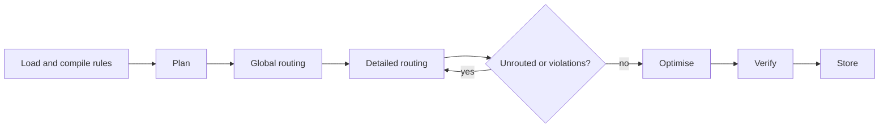

# Routing pipeline

The stages the Routing Manager runs for a full autoroute, the engine behind each, and the algorithm each starts with. Every algorithm sits behind its engine's contract and can be replaced without touching the others; the reasons for the choices are in [Algorithms](../Research/Algorithms.md).

[TOC]

## Overview

| Stage | Engine | Starts with | Parallel on |
| --- | --- | --- | --- |
| Compile rules | Rules | Dense constraint tables | — |
| Build layout | Layout Access | Obstacles inflated by clearance + half width, per net class and layer, in a uniform grid of buckets | Threads, by layer |
| Plan | Planning | MST/RSMT decomposition, matrix and bus recognition, escape patterns, ordering | Threads, by net |
| Global routing | Global Routing | Pattern routing, then PathFinder negotiation on a coarse 3D grid; track assignment on cell borders | Threads or GPU, by batch |
| Detailed routing | Detailed Routing | Octilinear A* on an implicit graph inside each corridor; negotiated local rip-up | Threads, by batch of regions |
| Repair | Detailed Routing | Walkaround and shove; later an exact switchbox solver | Threads, by window |
| Optimise | Optimization | Pull-tight, mitering, via removal, stub removal | Threads, by region |
| Verify | Verification | Full DRC with the compiled constraints, broad phase by spatial index | Threads, by tile |

## Stages

### Compile rules

The Rules Engine turns the design's rules into a `ConstraintSet`: a clearance matrix indexed by (net class, net class, layer), widths per net and layer, the allowed via stacks per net, differential pairs and length groups. Everything later asks the constraint set, in O(1), never the original rules. Verification uses the same constraint set, so there is exactly one interpretation of the rules.

### Plan

- **Decompose** each multi-pin net into two-pin connections: a rectilinear Steiner tree (FLUTE-style) or MST, and ordered chains for the rows and columns of a key matrix.
- **Recognise structure**: a switch and its diode become a short local stub; rows and columns become buses.
- **Pre-route patterns**: escapes for QFN and BGA pads from templates, plane-connection vias for GND and power, the coupled regions of differential pairs. Built so far: each hemmed-in SMD pin of a part with at least 8 pins gets a stub straight away from its part to where a track may turn, held as fixed copper of its net before anything is routed; the connections that leave the part start there ([[TRX-56]]). A via at the end of each stub was tried and rejected ([[Benchmarks#fine-pitch-pins-escaped-first-m5-trx-56]]). And each pad of a net with a plane on a layer that takes no tracks, which no plane joins yet, gets a short track to a via onto the plane beside it, the nearest place within 2 mm of its edge where both fit, before the escapes; what a plane joins needs no connection ([[TRX-58]]). Pours on layers that take tracks join nothing in planning: routes of other nets may cut them apart, and only the board program's refill tells where.
- **Order**: connections from hemmed-in pads (no track fits between them and another net's copper, as at a fine-pitch chip) first, then shortest first; ties by names, never by the order the board lists things in. Detailed routing then forms batches of connections whose territories are apart ([Parallelism and GPU](Parallelism-and-GPU.md#batches)).

### Global routing

> [!NOTE]
> Built, and off by default: on the keyboard and the key matrices, corridors made detailed routing slower ([[Benchmarks#global-routing-corridors-measured-and-off-m2-trx-26]]). Turn it on with `global_routing = true` ([[Profiles]]).

On a coarse 3D grid — cells of about 1–2.5 mm, one plane per copper layer — each edge has a capacity: the number of tracks that fit after obstacles.

1. **Pattern routing** of every connection: L, Z and 3-bend shapes with a dynamic program over layers. Embarrassingly parallel.
2. **Negotiation**: PathFinder with present and history costs over the connections that overflow, with bounded 3D A*, in batches, until no edge is overused or an iteration budget is spent.
3. **Track assignment**: choose where each connection crosses each cell border (interval assignment per border), ordered to minimise crossings inside the cells.

The output is a corridor per connection: its cells, layers and border crossings.

### Detailed routing

Inside its corridor, each connection is routed by A* over an implicit octilinear graph: the corners of inflated obstacles, the corridor's crossing points and a fine fallback grid. Clearance is checked exactly against Layout Access. Corridors of one batch don't overlap, so workers route them in parallel, each in a transaction (see [Parallelism and GPU](Parallelism-and-GPU.md)).

Built so far: a search leaves a pad by a straight stub to a grid node in or next to it, and also along the pad's eight axes, off the grid, to where the stub first crosses a grid line beyond the copper around it; a short jog square to that line joins the grid. So the pins of fine-pitch chips that lie off the grid, which only a track on their axis can leave, are routed ([[TRX-54]]). A connection may take routed copper's place at a price that grows with each rip-up of that copper, and each collision makes its place dearer for every later search (PathFinder's history cost, [[TRX-50]]). Planned: connections that fail, or conflict at commit, go to a local negotiation: the same PathFinder costs on a fine grid around the conflict, then **walkaround and shove** (moving neighbouring octilinear segments within the rules, as KiCad's interactive router does). Later, an exact ILP/SAT switchbox solver on small windows can route what is left, or prove that it can't be done and say so.

Differential pairs are routed as one coupled entity with pose-based A* (position and heading), then split into two tracks.

### Optimise

Region by region, on copy-on-write snapshots: pull-tight within each trace's channel, 45° mitering, removing via pairs that one layer can carry, reassigning segments to layers to save vias, removing stubs; later length tuning in reserved meander regions and teardrops. A move is kept only when it improves the cost and adds no violation.

Built so far ([[TRX-36]]): pull-tight, one track at a time, on one thread. Each run of a track's corners is replaced by the shortest octilinear way between its ends where that fits in the layout, which holds everything else as it is by then; the track's ends and the vias stay, so nothing joined comes apart, and no corner turns by more than 90°. It removes a quarter to a third of the corners on the corpus's larger boards, and under 1 % of the track length.

### Verify

An independent DRC over the result: clearances, widths, vias, unconnected pins, overlaps with keepouts and the board outline, plus metrics — completion, total length, vias, run time per stage. The router's own clearance checks are never trusted for sign-off. In the benchmark, KiCad's own DRC (`kicad-cli pcb drc`) is a second, external referee.

## Why this is much faster than Freerouting

Freerouting routes one connection at a time with a maze search over free-space *rooms* that are rebuilt after every change, escalates rip-up costs over many passes in place of negotiating congestion, has no global plan, and optimises by rerouting every item on a deep copy of the board, on one thread by default. Every row of the table above replaces one of those costs:

- the global plan removes most blind rip-up passes, and negotiation converges in a few iterations;
- a spatial index with inflated obstacles replaces rebuilding room polygons;
- batches of non-overlapping corridors route on every core;
- flat arrays of integers and cache-friendly heaps replace object graphs and a `TreeSet` priority queue.

A 4-layer keyboard has roughly 150–300 two-pin connections and 20–30 multi-pin row and column nets, dense only around the MCU and flash. The search work is small; the target is **well under a second to a few seconds** on a laptop CPU, without a GPU.
